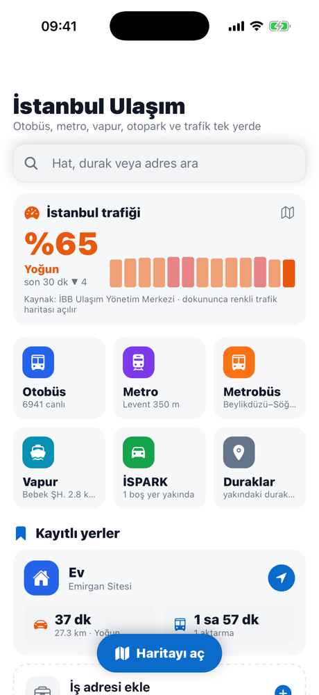
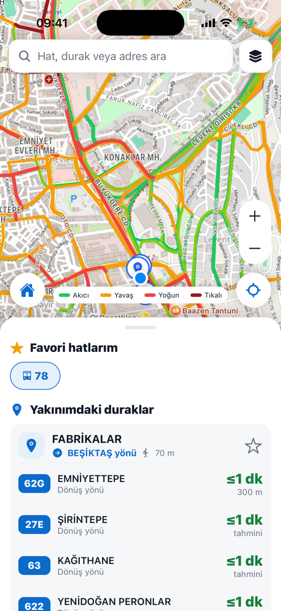
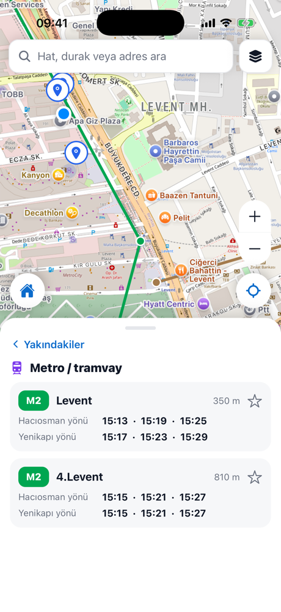
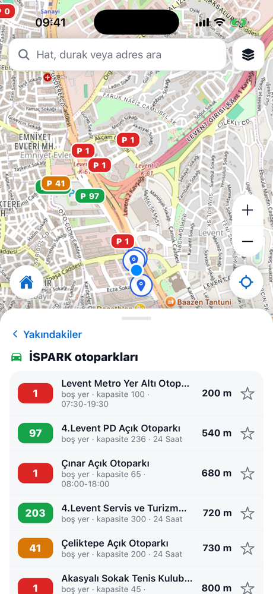
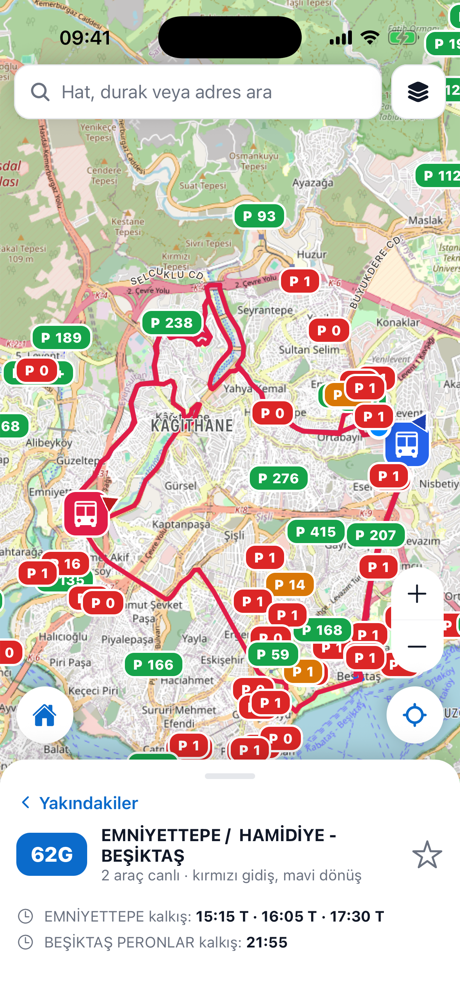
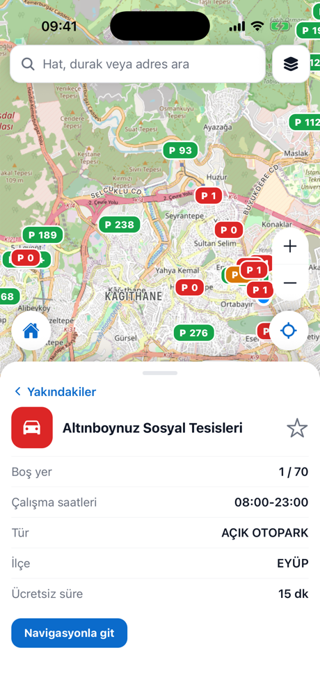
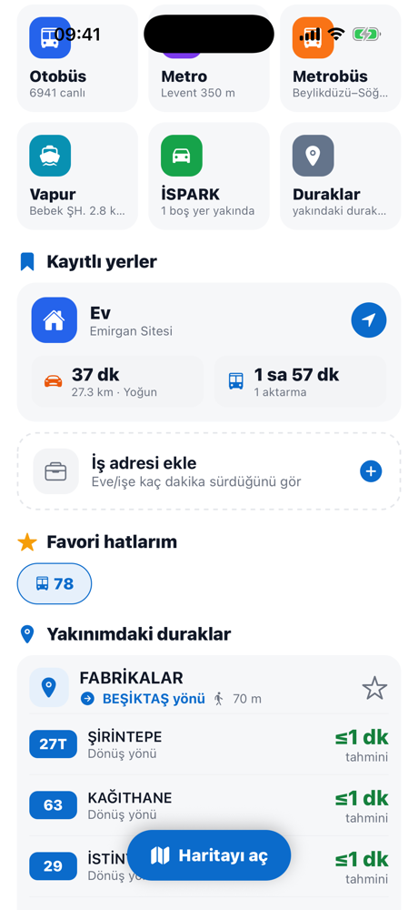

# İstanbul Ulaşım

İstanbul için tek uygulamada **otobüs, metro, metrobüs, Marmaray, vapur, otopark, trafik ve araçla navigasyon**.
Expo (React Native) mobil uygulaması + bağımlılıksız bir Node.js sunucusundan oluşur.

> **Durum: bireysel/deneysel proje.** Resmî bir İBB/İETT ürünü değildir. Veriler halka açık kaynaklardan alınır;
> doğruluk, süreklilik ve kullanım koşulları ilgili kurumlara aittir (aşağıdaki [Sınırlar](#sınırlar-ve-dürüst-notlar) bölümüne bakın).

## Özellikler

| Alan | Ne yapar | Veri |
|---|---|---|
| **Ana sayfa** | Trafik endeksi, kategori kartları, **kayıtlı yerler** (Ev / İş / yıldızlı yer; her kartta araçla trafikli ve otobüsle varış süresi), favori hat / durak / metro / otopark | İBB UYM, OSRM, kendi rota planlayıcı |
| **Otobüs** | Canlı otobüs konumu, hat güzergâhı ve animasyonu, gidiş/dönüş rengi, yön oku, durak varış tahmini, hat uyarıları, planlı kalkış saatleri | İETT SOAP, iett.istanbul |
| **Metro / tramvay** | Hatlar, istasyonlar, yakın istasyonda sıradaki seferler | Metro İstanbul API |
| **Marmaray ve M11** | Marmaray ile Havalimanı metrosu (M11) hat çizgisi ve istasyonları (statik, planlı) | İBB GTFS, OpenStreetMap |
| **Metrobüs** | Hat çizgisi ve duraklar | İBB GeoJSON / GTFS |
| **Vapur** | Resmî hat çizgileri, iskeleler, iskeleden planlı kalkışlar | İBB GeoJSON, Şehir Hatları sitesi |
| **İSPARK** | Canlı boş yer sayısı, favori otopark | İBB İSPARK API |
| **Trafik** | Şehir geneli endeks + yol yol renkli trafik haritası | İBB UYM |
| **Rota** | Toplu taşıma (aktarmalı, canlı ilk otobüs) ve **araçla navigasyon** (trafikli süre, Türkçe sesli yönlendirme, yeniden rota, akıcı sürüş kamerası) | OSRM, OSM Nominatim |
| **Arama** | Hat, durak ve adres tek kutuda | – |

## Ekran görüntüleri

<p align="center">
  
  
  
  
</p>
<p align="center">
  
  
  
</p>

*Ana sayfa · renkli trafik · metro · İSPARK · hat modu · otopark kartı · kayıtlı yerler (araçla/otobüsle süre). Görüntüler iOS Simülatörü'nden, canlı veriyle alınmıştır.*

## Mimari

```
mobile/   Expo (React Native) uygulaması (tek ekran: App.js + src/)
server.js Node 22, sıfır bağımlılık; kaynakları birleştirir, önbellekler, kota korur
data/     İBB GTFS/GeoJSON türevleri (bazıları üretilir, aşağıya bakın)
scripts/  data/routes.json üreten betik
public/   Eski web/PWA sürümü (güncel değil)
```

Uygulama sunucuya `http://<bilgisayar-ip>:3000` üzerinden bağlanır (geliştirmede Expo'nun bulduğu IP'yi kullanır,
yayında `EXPO_PUBLIC_API_URL` ile verilir).

## Kurulum

Gereksinimler: **Node.js ≥ 22**, mobil için Expo (Expo Go ya da simülatör).

### 1) Veri dosyasını üret (bir kez)

`data/routes.json` (≈50 MB) depoda yoktur; İBB'nin hat güzergâh GeoJSON'undan üretilir:

1. [İETT Hat Güzergâhları](https://data.ibb.gov.tr/dataset/iett-hat-guzergahlari) veri setinden GeoJSON'u indirin.
2. Üretin:
   ```bash
   node --max-old-space-size=6144 scripts/build-routes.mjs <indirdiginiz.geojson>
   ```

`data/stops.csv` ve `data/routes.csv` (İBB GTFS) ile `data/deniz_*.geojson`, `data/marmaray.json` depoda hazırdır.
`data/traffic_segments.json`, `data/ferry_times.json`, `data/busline.json` ve `data/ratelimit.json` çalışırken
sunucu tarafından kendiliğinden oluşturulan önbelleklerdir.

### 2) Sunucu

```bash
npm start            # http://localhost:3000
```

İsteğe bağlı ortam değişkenleri:

| Değişken | Anlamı |
|---|---|
| `PORT` | Sunucu portu (varsayılan 3000) |
| `AISSTREAM_API_KEY` | [aisstream.io](https://aisstream.io) anahtarı. Canlı vapur konumu için; İstanbul'da kapsama yoktur, boş çalışır |
| `NOCRAWL=1` | Arka plan hat taramasını kapatır |

### 3) Mobil uygulama

```bash
cd mobile
npm install
npx expo start       # Expo Go ile aynı Wi-Fi'de açın
# veya: npx expo run:ios   (simülatör; CocoaPods gerekir)
```

Sesli yönlendirme ve ekranın açık kalması için `expo-speech` ve `expo-keep-awake` kullanılır; eski bir yerel
derlemede bu modüller yoksa uygulama sessiz/ekran kilidiyle çalışmaya devam eder.

## Veri kaynakları

- **İETT**: `api.ibb.gov.tr/iett/FiloDurum/SeferGerceklesme.asmx` (`GetFiloAracKonum_json`, `GetHatOtoKonum_json`) ve
  `api2.ibb.istanbul` üzerindeki aynı servis. **Saatte 100 istek** sınırı vardır (resmî doküman V.1.5); sunucu bunu
  iki adres arasında paylaştırır ve diske yazılan bir sayaçla aşmamaya çalışır.
- **iett.istanbul** web sitesi: durak varış tahminleri (`GetStationInfo`), hat uyarıları (`GetLineStatus`), planlı kalkışlar.
- **Metro İstanbul**: `api.ibb.gov.tr/MetroIstanbul/api/MetroMobile/V2`.
- **İBB Açık Veri**: GTFS, hat/durak GeoJSON, deniz ulaşım hatları ve iskeleleri, İSPARK, trafik endeksi ve yol parçaları (UYM).
- **Şehir Hatları** hat sayfaları: planlı vapur kalkışları (günde bir, nazikçe, diske önbellekli).
- **OpenStreetMap katkıcıları**: M11 hat geometrisi ve istasyonları, İstanbul il sınırı (haritada il dışını renksiz gösterir) (ODbL).
- **OSRM** (herkese açık demo sunucusu) ve **OpenStreetMap Nominatim**: yol rotası ve adres arama. Demo sunucularının
  kullanım politikalarına uyun; yoğun kullanım için kendi örneğinizi kurun.
- **Harita altlığı**: OpenStreetMap karoları.

## Sınırlar ve dürüst notlar

- **İETT kota sınırı** en büyük zayıflıktır. Hat bilgisi (kapı no → hat) kota içinde zamanla birikir; kota dolunca canlı otobüs
  verisi gecikebilir. Kalıcı çözüm İETT'den kota artışı istemektir.
- **Resmî olmayan uçlar**: `iett.istanbul` sayfaları, UYM trafik servisleri ve Şehir Hatları sayfaları herkese açık web
  sitelerinin kendi kullandığı adreslerdir, haber vermeden değişebilir. Bunların kullanımı ilgili sitelerin koşullarına tabidir;
  üretimde kullanmadan önce izin/koşulları kontrol edin.
- **Canlı veri olmayanlar**: canlı vapur konumu, canlı Marmaray/metrobüs konumu, otobüs doluluğu yoktur.
- **Planlı veriler**: vapur ve metro saatleri tarifedir; iptal/gecikme yansımaz. Marmaray verisi 2024 tarihli GTFS'tir.
- **Navigasyon** adım adım sürüş içindir, resmî bir navigasyon ürünü değildir; trafik süresi tahmindir.
- Toplu taşıma planlayıcı yalnızca otobüs, en fazla 1 aktarma; süreler yaklaşıktır.
- Simülatörde yazı yazarken Türkçe karakter bozulabilir (uygulama bunu onarır); gerçek klavyede sorun beklenmez.

## Güvenlik ve gizlilik

- Depoda API anahtarı yoktur; anahtarları ortam değişkeniyle verin.
- Adres aramaları ve rota istekleri sunucu üzerinden üçüncü taraflara (Nominatim/OSRM) gider; cihaz konumu doğrudan gitmez.
- `NSAllowsArbitraryLoads` yalnızca geliştirmede yerel sunucuya HTTP ile bağlanmak içindir; yayında HTTPS kullanın.

## Katkı

Sorun bildirimi ve çekme isteği (PR) açabilirsiniz. Yeni veri kaynağı eklerken kaynağın kullanım koşullarını ve kota sınırlarını
README'ye yazın.

## Lisans

[MIT](LICENSE). Veri setleri kendi lisanslarına tabidir (İBB Açık Veri Lisansı, OpenStreetMap ODbL).
